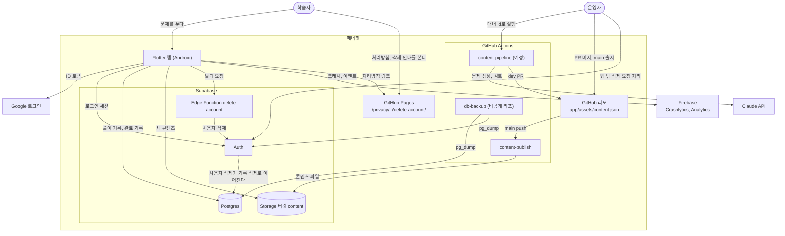

# 구조 그림 (C4 컨테이너)

시스템이 어떤 컨테이너로 나뉘고 무엇과 이어지는지만 그린다. 결정과 근거는 [`decisions.md`](decisions.md)와 ADR에 있다. 그림과 다르면 그쪽이 맞고, 이 그림을 고친다.

시스템 컨텍스트(1단계)는 이 그림의 바깥 상자와 같아서 따로 그리지 않는다. 컴포넌트(3단계)와 코드(4단계)도 그리지 않는다. 앱 안 모듈은 [README](../README.md)의 폴더 설명과 ADR 0002 §1이 원본이다.

| 컨테이너 | 원본 |
| --- | --- |
| 앱, 기기 안 기록, 동기화 | ADR 0001 §3, 0002, 0005 |
| Postgres, Auth, `delete-account`, 백업, Pages | ADR 0001 |
| Storage, `content-publish` | ADR 0003 §5 |
| `content-pipeline` | ADR 0009 |
| Firebase | ADR 0006, 0007 |
